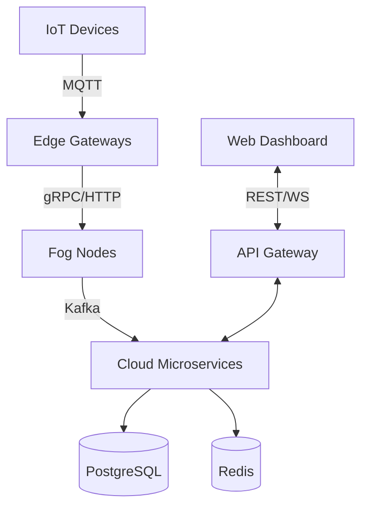
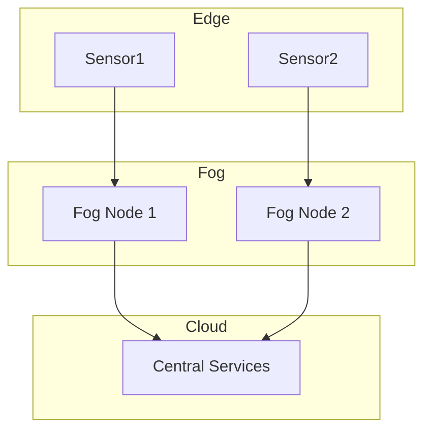
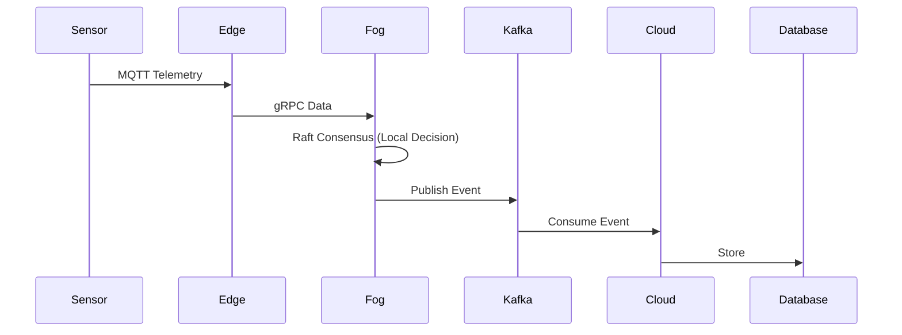
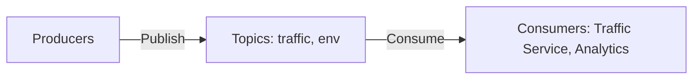
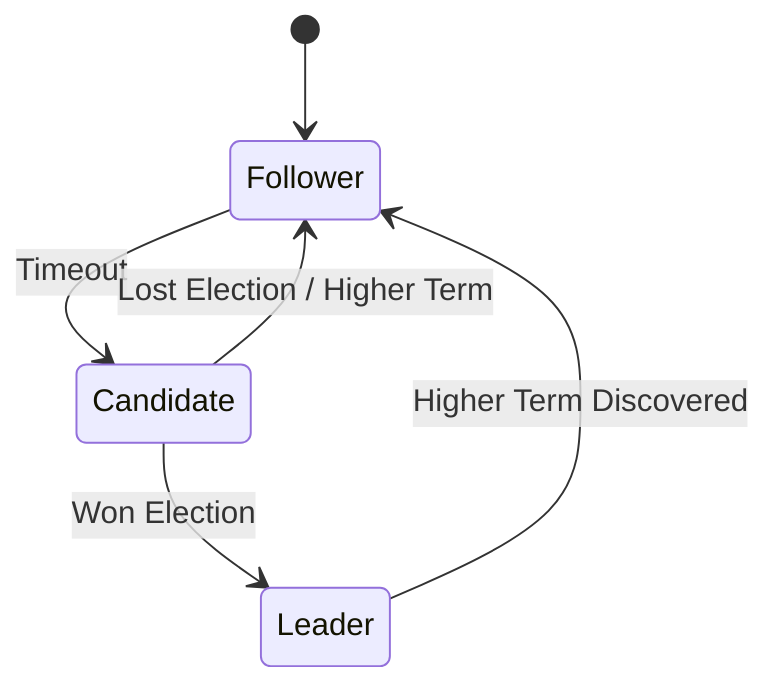
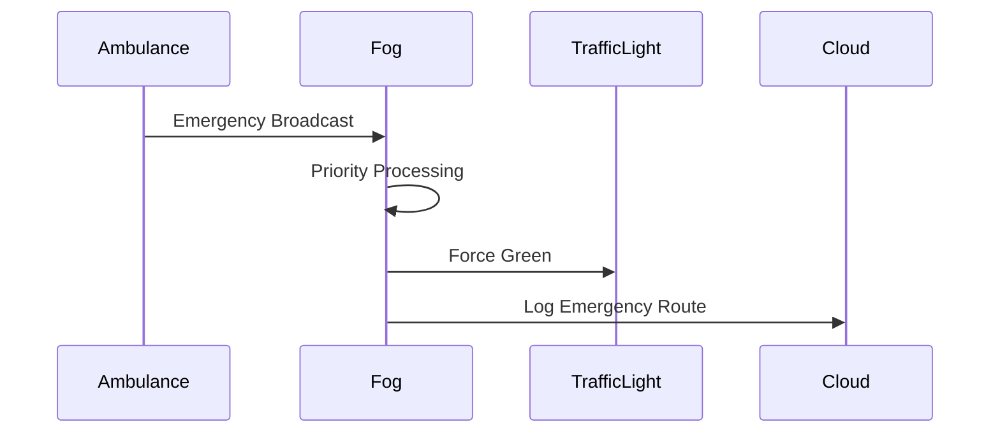
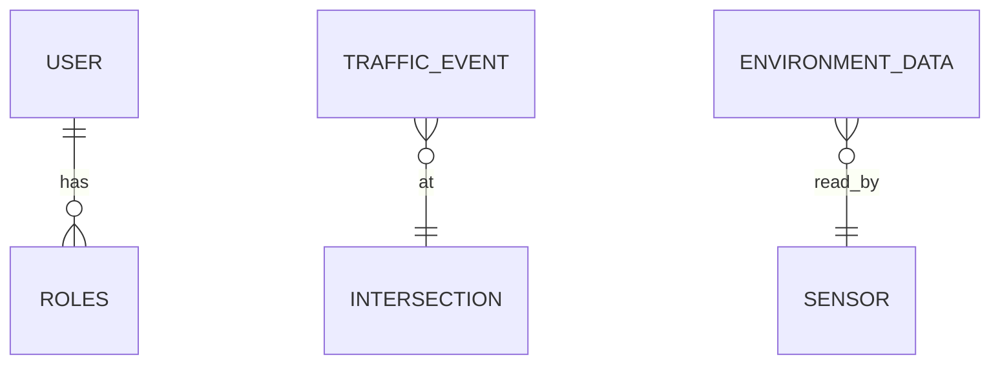
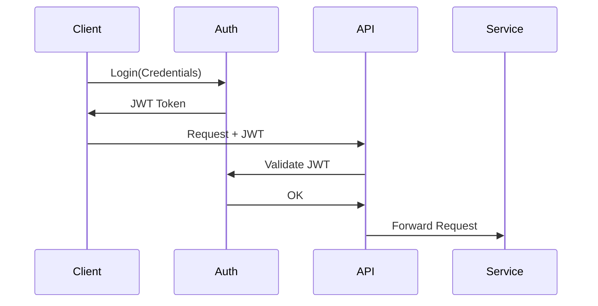

# Architecture Documentation

## 1. High-level system architecture

## 2. Edge-Fog-Cloud hierarchy

## 3. Traffic data flow

## 4. Kafka event flow

## 5. Raft consensus state machine

## 6. Emergency response flow

## 7. Database architecture

## 8. Authentication/security flow

